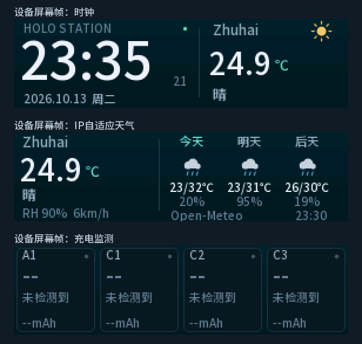

# ESP32-C3 HoloStation Weather & Charge Monitor

为 HoloStation 风格充电站重新编写的 ESP32-C3 固件，支持四路功率监测、充电量统计、桌面时钟、按公网 IP 自动定位的天气预报，以及 USB / 网页配网。



版本：`1.1.6-weather.3` · ESP-IDF `v5.5` · 4 MB Flash · 横屏 `284 × 76`。

这是新编写的功能复刻工程。板级参数和兼容命令参考用户提供的 holoStation v1.1.6 固件，界面采用重新生成的抗锯齿字库；本仓库不包含原厂固件或原作者未公开的完整源工程。

## 功能

- 四路 INA226：电压、电流、功率、本次会话时长、累计输出电荷量 **mAh** 和能量 **Wh**。
- 每路电流达到或超过 **0.05 A** 开始/继续累计；连续低于阈值 **3 秒**，清空该路本次 mAh、Wh 和计时。网页可调整延时。
- 连续有效采样采用梯形积分；瞬间电流跌落、传感器失联和长采样间隔不会错误补计电量或误清零。
- 时钟、自动轮播、原生字号 4 位灰度抗锯齿字体、天气图标和四路充电卡片。
- 亮度、跨午午夜间模式、主题、自定义 JPEG 背景和双分区 OTA。
- BLE：`HoloStationV3`，服务 `180A`，通知 `2A29`，写入 `2A24`，保留原 JSON 命令。
- Windows USB 串口配网工具，以及设备内置网页控制面板。

累计值是充电接口的输出电量，保存在 RAM；重启、OTA 或满足清零条件时清空。它不直接等于电池内部的真实容量。

## 按 IP 自动定位天气

设备联网、SNTP 校时后，通过 HTTPS 请求 [ipwho.is](https://ipwhois.io/documentation)，根据**设备的公网出口 IP**获取城市、经纬度和时区，再请求 [Open-Meteo](https://open-meteo.com/en/docs) 的实时天气和三天天气预报。

- 城市不固定；原先手动指定珠海的旧配置会自动迁移到 IP 定位模式。
- 天气刷新时重新定位，正常间隔 30 分钟；Wi-Fi 重连也会触发更新。手动刷新至少间隔 1 分钟。
- 定位暂时失败时，使用上次成功的定位并标记缓存；首次定位失败时显示等待状态。
- 显示温度、天气、湿度、风速，以及三天最低/最高温与降雨概率。
- 城市使用接口返回的英文名称，长名称自动缩小或截断，适配小屏幕。
- VPN、代理、移动网络和运营商出口会影响 IP 定位结果。

`ipwho.is` 会收到设备的公网 IP；Wi-Fi 密码不发送给定位或天气服务。固件保持 HTTPS 证书校验。免费服务配额和条款请以服务官网为准。

## USB 串口配网工具

工具源码和启动脚本均在 [`tools/usb_setup`](tools/usb_setup)。Windows 无需安装 Python：

1. USB 数据线连接设备。
2. 双击 `tools/usb_setup/Open_USB_Setup.cmd`。
3. 选择串口，填写 **2.4 GHz** Wi-Fi 名称和密码，点击“保存并联网”。
4. 工具显示设备获取的 IP、天气和传感器状态，可切换时钟、充电、天气页面。

密码只保存到设备 NVS，不写入电脑文件、不包含在状态回复中。工具生成的 `HoloStation_last_status.json` 仅供本机查看，并已被 Git 忽略。

## 网页配置

连接设备热点 `HoloWeather-XXXX`，密码 `WeatherXXXX`，其中 `XXXX` 是设备 MAC 最后两字节的十六进制后缀。访问 `http://192.168.4.1/`；已配网时也可访问 USB 工具显示的设备 IP。

网页提供配网、页面切换、mAh/Wh 查看、亮度/夜间模式、清零延时、背景上传和 OTA。

HTTP/USB `/api/status` 各路增加 `mAh`、`Wh`；`weather` 包含 `city`、`autoLocation`、`locationCached`、`timezone` 等字段。BLE 遥测保持原结构，避免新增字段后超出 517 字节 MTU。

## 编译

安装并激活 [ESP-IDF v5.5](https://github.com/espressif/esp-idf/tree/v5.5)，在项目根目录运行：

```sh
idf.py set-target esp32c3
idf.py build
idf.py -p COM6 flash
```

`main/idf_component.yml` 固定 `espressif/esp_jpeg` 为 `1.3.1`，组件管理器会下载依赖。`main/font.c` 已包含可编译字库，普通编译不依赖字体文件或 Pillow。

重新生成字库：安装 Pillow，下载 [Noto Sans SC](https://github.com/google/fonts/tree/main/ofl/notosanssc) 可变字体，运行：

```sh
python tools/generate_font.py NotoSansSC.ttf
```

## 预编译固件

[`firmware`](firmware) 包含应用、引导程序、分区表、OTA 初始化数据、合并镜像和 SHA256 校验表。

- `app.bin`：用于本项目设备网页 OTA。只接受项目名为 `holo_weather_station` 的应用文件。
- `merged.bin`：从 `0x0` 串口烧录的完整合并镜像；它包含空白 NVS 间隙，重新烧录后需重新配网。

```sh
python -m pip install esptool==5.1.0
python -m esptool --chip esp32c3 --port COM6 --baud 460800 write-flash 0x0 firmware/merged.bin
```

分文件烧录地址：`bootloader.bin` → `0x0`，`partition-table.bin` → `0x8000`，`ota_data_initial.bin` → `0xe000`，`app.bin` → `0x10000`。

发布固件和本仓库不含用户 Wi-Fi 配置、原设备闪存备份或访问令牌。

## 硬件

| 项目 | 配置 |
| --- | --- |
| MCU | ESP32-C3，4 MB Flash，DIO 80 MHz |
| 屏幕 | ST7789P3，284×76，RGB565 大端 |
| SPI2 | MOSI=1、SCLK=0、CS=6、DC=10、RST=3、背光=7 |
| 屏幕方向 | gap(18,82)，swapXY，mirror(false,true) |
| I2C | SDA=4、SCL=5，100 kHz |
| INA226 地址 | A1=0x43、C1=0x42、C2=0x41、C3=0x40 |
| 分流电阻 | 0.005 Ω |
| 校准最大电流 | 3.5 A、3.5 A、7 A、6 A |

仅 USB 给控制板供电时，充电模块的 INA226 可能不会应答；界面会显示“未检测到”。真实负载计量仍需给充电模块供电后比对。

## 验证与项目结构

已完成 ESP32-C3 编译、设备 OTA、重新联网、IP 自动定位和实际屏幕帧检查。主机测试包括充电量计算 24 项、定位解析 29 项、天气解析 115 项。

```text
main/                       屏幕、测量、会话积分、BLE、Wi-Fi、USB、网页与 OTA
components/weather_component/  天气与 IP 定位服务、解析模型及天气测试
tests/                      充电量与 IP 定位解析测试
tools/usb_setup/             Windows USB 配网工具
tools/generate_font.py       字库生成工具
firmware/                   无私人配置的预编译固件
docs/images/                界面示例
```

## 第三方来源

- [Espressif ST7789 驱动](https://github.com/espressif/esp-idf/blob/v5.5/components/esp_lcd/src/esp_lcd_panel_st7789.c) 与 [NimBLE 示例](https://github.com/espressif/esp-idf/tree/v5.5/examples/bluetooth/nimble/bleprph)：ESP-IDF / Apache-2.0。
- INA226 协议依据 [TI 数据手册](https://www.ti.com/lit/ds/symlink/ina226.pdf) 独立实现。
- Noto Sans SC：SIL OFL 1.1，许可证见 `third_party/NotoSansSC-OFL.txt`。
- cJSON：MIT，许可证见天气组件 `third_party/cjson/LICENSE`。
- JPEG 解码：[espressif/esp_jpeg](https://github.com/espressif/idf-extra-components/tree/master/esp_jpeg)，依赖清单固定版本。
- 天气数据来源 Open-Meteo，设备界面保留署名。
